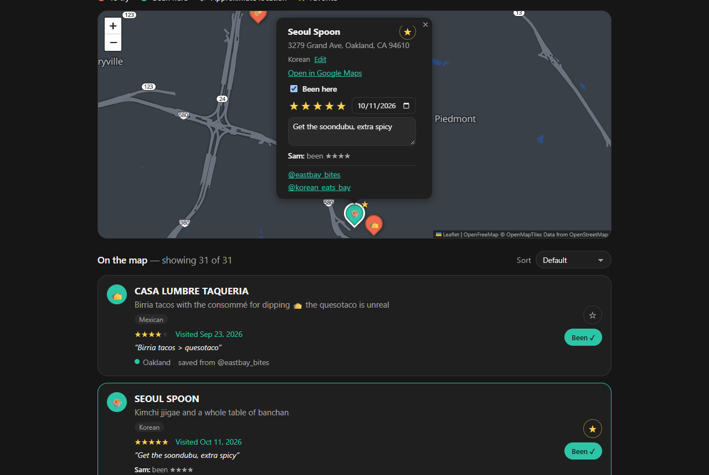
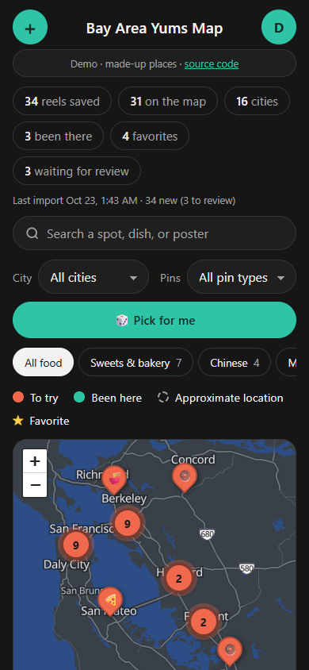
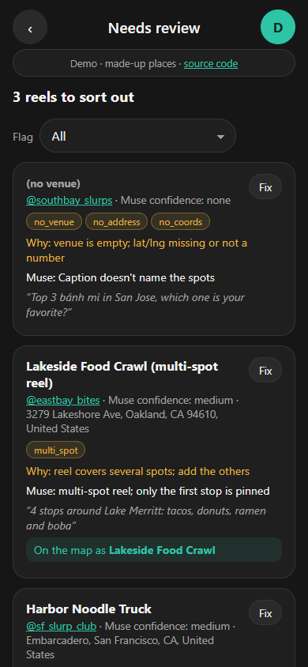

# Bay Area Yums Map

A phone-first map of Bay Area restaurants saved from Instagram food reels, with a "been here" log for two friends.

**Live demo: [yums-map-demo.fly.dev](https://yums-map-demo.fly.dev)**. Click "Try the demo". It uses made-up places, and anything you change resets on its own.

<p>
  
  
  
</p>

## Features

- **Map of saved places:** coral pins to try, teal pins visited, dashed pins approximate. Crowded areas cluster and split as you zoom.
- **Search and filters** by spot, dish, poster, city or food type.
- **Pick for me:** 🎲 flies to a random place you haven't tried, from whatever the filters show.
- **Visit log:** mark places "been here" with stars, a date and a note, and favorite the ones you want to try.
- **Two people, separate logs:** each person's ratings show in the other's popup, plus a "Both want to go" filter.
- **Review queue:** reels the import couldn't place wait here and can be fixed by dropping a pin.
- **Add places by hand**, with a warning if it's already on the map.
- **Open in Google Maps** from any place's popup.
- **Phone first:** installs to the home screen, clears the iPhone status bar, sized for tapping.

## Engineering highlights

- **Import pipeline for messy data.** Saved reels are exported as JSON by Meta's Muse AI, and the export is inconsistent: nulls vs. empty strings, ALL-CAPS names, swapped coordinates, multi-spot reels. Each reel is flagged for what's missing, and anything that can't be placed safely goes to a review queue instead of the map. A broken file stops the import with its line and column and writes nothing. Re-running only adds reels it hasn't seen.
- **Careful merging.** Duplicates are caught through normalized reel URLs. Places merge only on the same street address *and* a fuzzy name match, since food halls share an address.
- **Auth done properly for a small app.** scrypt password hashes, HttpOnly session cookies, only hashes of session tokens stored, and a 15-minute lockout after 5 wrong passwords.
- **No API keys anywhere.** The basemap is [OpenFreeMap](https://openfreemap.org) vector tiles drawn by MapLibre GL, restyled to a minimal dark palette.
- **Tested and deployed.** 96 pytest tests cover the parser, flags, import rules, API, logins and demo. The frontend is typechecked and UI flows were checked in headless Chrome. One Docker image runs on Fly.io; the demo is the same image with a throwaway database rebuilt from sample data every 24 hours.

## Stack

Python 3.12 · FastAPI · SQLAlchemy 2.0 · SQLite · React 18 · TypeScript · Vite · Leaflet · MapLibre GL · Docker · Fly.io

## Quick start

Requires Python 3.12 and Node 20+.

```bash
# backend/ : API on http://localhost:8000 (docs at /docs)
cd backend
python -m venv .venv
source .venv/bin/activate          # Windows: .venv\Scripts\activate
pip install -r requirements.txt
uvicorn app.main:app --reload

# frontend/ : app on http://localhost:5173 (second terminal)
cd frontend
npm install
npm run dev
```

You'll need an account and some imported reels to see anything. See [docs/setup.md](docs/setup.md).

## More

- [docs/setup.md](docs/setup.md): accounts, importing reels, hosting, backups and tests
- [ROADMAP.md](ROADMAP.md): what's done and what's next
- [CLAUDE.md](CLAUDE.md): data model, import rules, flag definitions and API reference

## License

[MIT](LICENSE)
